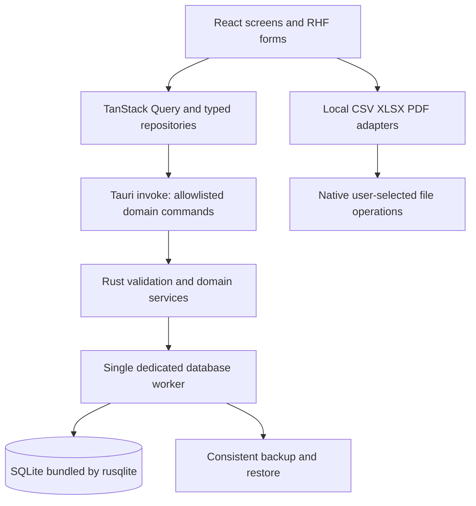

# PackFlow — architecture, integration and operations

Baseline: 11 October 2026. Chosen scope and rules are in [PLAN.md](PLAN.md).

## 1. Stack and exact candidate versions

These versions were read from official npm registry latest metadata and crates.io stable metadata during planning. They are candidate pins, not a claim that a complete application has compiled with them. M0 must verify resolution, frontend production build, native compile, transactions and backup on macOS before accepting the lockfiles. Do not use floating latest ranges. Rust 1.99.0 and Node 24.21.0 LTS were read from the official distribution metadata; Tauri 2.12.3 declares Rust >=1.90. Use npm and commit package-lock.json and Cargo.lock when implementation begins.

| Component | Pin | Rationale / license |
| --- | --- | --- |
| Node build tooling | 24.21.0 LTS | Satisfies Vite/Vitest current engine ranges; not a desktop runtime dependency |
| Rust toolchain | 1.99.0 | Meets inspected Tauri minimum; pin rust-toolchain.toml |
| tauri Rust / JS API | 2.12.3 / 2.12.3 | Native shell and typed IPC; MIT OR Apache-2.0 |
| @tauri-apps/cli | 2.12.2 | Build/bundle CLI; MIT OR Apache-2.0 |
| tauri-plugin-dialog Rust / JS | 2.8.2 / 2.8.2 | Native file selection; MIT OR Apache-2.0 |
| tauri-plugin-single-instance Rust | 2.5.3 | Focus existing window instead of second writer; MIT OR Apache-2.0; no JS package required |
| rusqlite | 0.40.2, bundled + backup features | Rust connection/transaction/backup ownership; MIT |
| React / react-dom | 19.3.0 / 19.3.0 | Component frontend; MIT |
| TypeScript | 7.0.2 | Strict frontend types; Apache-2.0 |
| Vite | 8.3.4 | Static local UI build; MIT |
| Tailwind / @tailwindcss/vite | 4.3.3 / 4.3.3 | Design system; MIT; supports Vite 8 peer range |
| @tanstack/react-query | 5.104.2 | Async IPC queries and invalidation; MIT; React 19 supported by peer metadata |
| react-hook-form / @hookform/resolvers | 7.90.0 / 5.9.1 | Forms + Zod resolver; MIT; inspected peers match |
| zod | 4.6.6 | Frontend DTO/form validation; MIT |
| lucide-react | 1.55.0 | Bundled consistent icons; ISC |
| vitest / @playwright/test | 5.0.3 / 1.64.0 | Frontend and browser workflow checks; MIT / Apache-2.0 |
| exceljs | 4.4.0 | Browser XLSX read/write; MIT; established stable version, offline/worker spike required |
| pdf-lib | 1.17.1 | Local PDF generation; MIT; older stable version, keep isolated and verify needed behavior |

Transitive support dependencies (React types, Vite React plugin, fontkit if required for PDF fonts, serde/uuid/hash/archive helpers and native test harness) must be resolved and license-recorded during M0/M5, rather than claiming their compatibility here. Vite React plugin must support Vite 8 and React 19; if no compatible maintained release resolves, stop the spike and document a coherent version adjustment before proceeding. PDF/XLSX libraries are selected for the limited v1 capability, not advertised as recently maintained. Record dependency licenses and vulnerability review in release notices; SQLite is public domain; DM Sans/Manrope font notices use SIL OFL. No commercial PDF/printing SDK.

Metadata sources: [npm registry](https://registry.npmjs.org/), package-specific /latest endpoints (for example [React](https://registry.npmjs.org/react/latest), [Vite](https://registry.npmjs.org/vite/latest), [Tailwind](https://registry.npmjs.org/tailwindcss/latest)); [Tauri crates metadata](https://crates.io/api/v1/crates/tauri), [rusqlite crates metadata](https://crates.io/api/v1/crates/rusqlite), [Rust stable manifest](https://static.rust-lang.org/dist/channel-rust-stable.toml), [Node release index](https://nodejs.org/dist/index.json). Package metadata is the version source where narrative documentation/search indexes lag.

## 2. Native boundary and database ownership



Official Tauri SQL plugin is a valid frontend SQL bridge backed by sqlx. Its documented select/execute APIs do not establish a frontend transaction handle with guaranteed connection affinity across separate calls. PackFlow therefore does not install it or use its migration runner. This is a design choice to centralize writes and validation, not a claim that the plugin cannot execute any transactions. Rust-owned rusqlite transactions are the only write path; reads also use typed commands. Drizzle is omitted: a custom proxy adapter adds mapping and transaction surface without a needed benefit, and a second migration authority would conflict. Node-only database bindings cannot run as WebView database drivers.

One Rust database worker owns one connection and processes bounded requests serially off the UI thread. Domain commands receive validated payloads, then perform all invariant reads, inserts/updates and audit changes in one transaction. Use BEGIN IMMEDIATE for write operations, prepared statements, checked arithmetic, and a 5-second busy timeout. Commands either commit a coherent result or roll back. No raw SQL IPC, shell execution, SQL console, or network API. Progress callbacks are allowed for long file jobs; cancellation before DB commit leaves no partial import.

Register the single-instance plugin first; one main window. A second launch focuses the existing instance. Restore/migration enters maintenance mode and rejects new writes. External SQLite tools are unsupported while the app is open. Check stale expected_version for mutable order/template/client/worker records even with a serialized writer to protect old UI forms. Lost replies are retried with the same request_id and return the previously committed result.

## 3. DTOs and repository contracts

Rust DTOs serialize through serde; TypeScript equivalents live in one contracts module and have round-trip fixtures to detect mismatch. Strings represent UUIDs, ISO dates, UTC timestamps, minor-unit amounts and scaled quantities over IPC. This avoids JavaScript unsafe integers; Rust parses/range-checks to i64 and frontend uses BigInt for money previews. JSON never contains BigInt. Integer box counts and minute counts have explicit bounded numeric DTO fields.

Mutation envelope: request_id UUID, actor_id, expected_version when editing, payload. Result: data, changed_entities (type/id pairs), committed_at. Domain errors: VALIDATION with field paths, NOT_FOUND, CONFLICT, INVARIANT, DUPLICATE_IMPORT, BUSY, STORAGE, FILE_ACCESS, BACKUP_INVALID, SCHEMA_TOO_NEW. Display actionable errors; don't retry validation failures. Disable repeat submission while pending and retain the same request ID on uncertain retry; buttons alone are not idempotency.

| Repository / command group | Interfaces |
| --- | --- |
| Clients/workers | list/get/create/update/archive; worker activate/inactivate |
| Orders | list/get/create/update; revise_quote; cancel/reopen/close/archive |
| Stages | template CRUD/reorder/archive; order-stage add/update/reorder/retire; update_status; assign_workers |
| Work | post_work; reverse_work; record_finished; reverse_finished |
| Expenses | list/post/reverse/replace; group totals by order/stage/category |
| Dispatches | list/post/reverse/replace, with multiple item quantities |
| Payments | list/record_receipt/record_refund with original-payment allocations |
| Reports | dashboard; production; dispatch; financial; stage; worker_effort; snapshot_export |
| Operations | settings read/update; preview_import/commit_import; create_backup/list_backups/restore; file selection/read/write |

Forms validate Zod rules; native domain code repeats all business validation and FK checks. UI submits domain intent, not computed balances. Query keys: clients, workers, templates, orders(filter), order(id), stage(id), payments(filter), expenses(filter), reports(filter), dashboard, settings, backups. Mutations invalidate affected detail/list/summary/report keys only after commit; financial writes invalidate balances/costs as appropriate. Don't optimistically update money or quantities. React component state owns transient tabs/dialogs/filter input; no Zustand in v1 and no full database mirror.

## 4. Planned repository layout

Keep prototype/ and existing docs/ unchanged. Add the implementation beside them, not inside prototype/dist.

```text
src/
  app/                  # shell, navigation, providers
  components/           # shared accessible UI
  features/             # orders, stages, clients, payments, costs, workers, reports, settings
  contracts/            # typed IPC DTOs and Zod adapters
  data/                 # invoke repositories, query keys, query hooks
  documents/            # CSV/XLSX/PDF, fonts, export schemas
  styles/               # tokens and Tailwind entry
src-tauri/
  src/commands/         # IPC boundary, no independent business rules
  src/domain/           # orders, stages, work, dispatch, payments, expenses
  src/db/               # worker, prepared repositories, migration runner
  src/operations/       # file grants, backups, restore, imports
  migrations/           # SQL embedded in binary, one native owner
  capabilities/         # main-window allowlist
tests/                  # contracts, browser workflows, native integration
planning/               # approved specification
```

## 5. Persistence, migrations and security

Resolve Tauri app_data_dir for bundle identifier; keep packflow.sqlite under data/, backups under backups/, and operation temporary files under tmp/. On macOS this is under the user's Application Support directory, resolved via APIs rather than hardcoded home paths. Development bundle/data directories differ from production. Closing/replacing the executable never removes business data.

Connection setup: foreign_keys=ON, WAL, synchronous=FULL, busy_timeout=5000; verify settings and schema before serving requests. Run quick_check at startup; failed integrity opens recovery UI and disables writes. Never silently create a fresh DB over corrupt data. Backup before upgrades, then checksum-verified ordered embedded migrations within transactions and write schema_migrations metadata atomically. Refuse newer schema versions. Rehearse failure midway through a migration; prior schema/data must remain intact. WAL behavior uses bundled SQLite verified in M0, with its exact version saved in build diagnostics.

Use least-required Tauri main-window capabilities: registered domain/file commands, chosen dialog operations, minimal window/core controls. No generic frontend filesystem or SQL plugin permission. Native file picker grants opaque short-lived handles to specific selected paths for import/export/backup; accept handles, not arbitrary frontend absolute paths. Directory grants expire on restart except configured backup location, which Rust stores and validates. Reject path traversal/symlink escapes from backup archives. Production CSP permits only bundled assets and required Tauri IPC origins; no remote fonts, arbitrary HTTP, unsafe-eval or inline event handlers. Blob document previews, if used, are restricted to required directives. Development CSP exceptions never ship.

No attachments or external document assets in v1. All business data/settings are SQLite-backed; fonts/templates are app resources. Backups are local and unencrypted by default, controlled by OS file permissions; encryption/key recovery is separate scope. The app makes no promise of role-based authorization or encrypted-at-rest security. Logs omit customer payment descriptions/contact payloads; use request IDs and error codes for diagnostics.

## 6. Backup and restore procedure

Use rusqlite's SQLite online backup API on the database worker to create a consistent snapshot. Never copy only the live main file in WAL mode. Write temporary snapshot, run integrity_check and foreign_key_check, calculate checksum, add manifest (format/app/schema/SQLite versions, timestamp, currency, timezone, file sizes/hashes), then publish a .packflow-backup archive by atomic rename on the target filesystem. Failure never records a successful backup. Attachments are absent, so the archive contains database + manifest only.

Default schedule: one successful daily backup on first launch and business-date rollover while running, plus pre-migration and manual backups. Startup catches up if no successful backup exists for today. Default keep last 14 daily + 3 pre-upgrade backups; safety restore backups are not pruned automatically. Prune only after a new backup passes validation. Local default target is app backups directory; setup recommends selecting an external drive for hardware-loss protection. Missing/full/read-only target produces a persistent banner, last successful timestamp and Retry/Change location actions. Local backup protects against logical mistakes, not loss of the Mac. No promise of backups while closed; no LaunchAgent.

Restore: validate archive limits/paths/manifest/checksums and schema compatibility in temporary storage; open candidate DB and integrity/FK-check it. Pause writes and make a validated safety backup in app-managed storage; abort if that fails. Close active DB, move current database/WAL/SHM as a recovery set, place candidate atomically, reopen, run allowed upgrades if needed, and revalidate. On any failure restore the original set and reopen it. Keep a durable restore journal so startup completes or rolls back an interrupted swap. After success clear query caches and reload all screens; retain the safety archive. Rehearse both healthy and interrupted restore before live use.

## 7. macOS build and testing

Build on macOS with Xcode Command Line Tools, pinned Rust/Node, aarch64-apple-darwin and x86_64-apple-darwin targets. Prefer universal bundles, with release tests on both architectures or clearly record an unverified target as unreleased. Browser UI development can happen on Windows; WKWebView, macOS dialogs, packaging/signing and restore integration need a Mac. macOS 14+ is the chosen product floor; Tailwind 4 documents Safari 16.4+ and does not establish native compatibility by itself.

Tauri's current WebDriver documentation describes macOS support through WebdriverIO's embedded server, while direct tauri-driver remains Windows/Linux only. M0 verifies embedded native automation on the target Mac before selecting/pinning the harness. If the spike cannot run it reliably, retain browser automation plus a documented native manual acceptance suite; do not claim automated macOS coverage. Embedded driver/debug plugins are test-only and excluded from production binaries.

Release pipeline: frontend typecheck/tests/build, Rust unit/real-file integration tests, browser workflows, native smoke and restore drill, bundle both CPU targets, license notices, checksum artifacts. Developer ID signing/notarization occurs only with supplied credentials; Apple's distribution verification needs network during release, but ordinary app use stays offline. Manual update installer preserves app data and migration backup. Newer databases cannot open in older binaries; restore a compatible backup rather than downgrading schema blindly. No in-app updater in v1.

## 8. Official references checked

- [Tauri SQL plugin](https://v2.tauri.app/plugin/sql/): frontend SQL bridge and migrations; assessed but not selected.
- [Drizzle proxy](https://orm.drizzle.team/docs/connect-drizzle-proxy): custom driver boundary; no verified turnkey Tauri transaction solution assumed.
- [rusqlite](https://github.com/rusqlite/rusqlite) and [backup module](https://docs.rs/rusqlite/latest/rusqlite/backup/index.html): chosen native connection and backup implementation.
- [SQLite online backup](https://www.sqlite.org/backup.html): consistent snapshots, including alternatives to copying live files.
- [Tauri prerequisites](https://v2.tauri.app/start/prerequisites/), [capabilities](https://v2.tauri.app/security/capabilities/), [single instance](https://v2.tauri.app/plugin/single-instance/), [macOS signing](https://v2.tauri.app/distribute/sign/macos/).
- [Vite prerequisites](https://vite.dev/guide/) and [Tailwind compatibility](https://tailwindcss.com/docs/compatibility).
- [Tauri WebDriver](https://v2.tauri.app/develop/tests/webdriver/): distinguish embedded macOS automation from direct driver support.
- [ExcelJS](https://github.com/exceljs/exceljs), [pdf-lib](https://pdf-lib.js.org/), [DM Sans license](https://github.com/google/fonts/blob/main/ofl/dmsans/OFL.txt), [Manrope license](https://github.com/google/fonts/blob/main/ofl/manrope/OFL.txt).

Do not interpret documentation review or registry peer metadata as a substitute for M0 compatibility testing.
