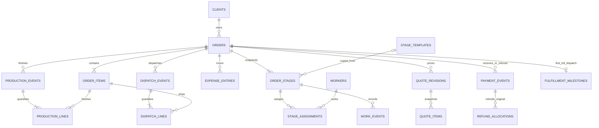

# PackFlow — proposed SQLite model and domain invariants

This is an illustrative planning schema/data dictionary, not a migration. Implement only after planning review. Product rules: [PLAN.md](PLAN.md); integration/ownership: [ARCHITECTURE.md](ARCHITECTURE.md).

## 1. Conventions and exact values

UUID text primary keys generated by Rust. Stable internal IDs differ from PF order numbers. Common mutable records have created_at/updated_at UTC RFC3339 instants and version >=1; audited events have created_at and actor_id. Business dates are validated YYYY-MM-DD; due dates are date-only, not midnight timestamps. Times are whole minutes. Currency is KWD, exponent 3, fixed for v1; 1 KWD = 1000 fils. A configuration edit cannot reinterpret stored currency.

Money is signed SQLite INTEGER fils, bounded abs(value) <= 9,000,000,000,000. Ordinary charges/receipts/expenses are nonnegative; reversals carry separate kind and a nonnegative amount. Quantities for stage work/materials are scaled integers with exponent 3, bounded 0..1,000,000,000 (up to 1,000,000.000 Unit). Ordered/finished/dispatched boxes are whole integers, 1..1,000,000 per order item. Times are bounded 0..1,000,000 minutes per work record. Enforce total/range caps after aggregation too; reject overflow before commit.

Unit-cost expense line total = round_half_up(quantity_scaled × unit_cost_fils / 1000), once per line. Native uses checked wide integer intermediates. Explicit total-amount mode stores entered total fils and optional descriptive quantity, with no computed unit cost; calculated and manually entered totals are not independently editable. Final quote per-box multiplication uses integer box quantity × integer unit price fils and adds exact line totals. Decimal inputs exceeding three digits are rejected, not silently truncated. Money/quantity DTO values are decimal integer strings; backend is authoritative, frontend BigInt previews follow the same fixture rules.

Foreign keys use RESTRICT, never cascading deletion of business history. Booleans have CHECK IN (0,1); enums constrained by CHECK. Composite FK/index keys enforce order consistency on stage/item links. Physical delete is limited to never-referenced templates and unused draft entities; normal UI archives/retirement/reversal preserve records. Internal demo database is separate.

## 2. Relationships

Every business event additionally references ACTORS. AUDIT_EVENTS, MUTATION_REQUESTS, IMPORT_BATCHES, SEQUENCES, SETTINGS, SCHEMA_MIGRATIONS and BACKUP_RUNS are operational tables. The 14 October salary amendment adds salary calculation tables; there are no inventory, invoice, supplier-payment, tax or currency-conversion tables.

## 3. Table dictionary

13 October amendment: migration 003 adds nullable `orders.payment_due_date`, a calendar-validated agreed customer payment deadline separate from production `due_date`. The native `set_payment_due_date` command checks optimistic order version and audits changes or clearing. `client_insights` derives uncapped rankings, positive outstanding balances, separate order credits, partial/settled counts, instalment counts, deadline coverage, overdue amounts/age and receipt-after-deadline counts from canonical order/financial/payment data. No statistics or client-score table is stored. See the date and denominator definitions in PLAN.md.

12 October implementation amendment: migration 002 adds `outside_services` (id, order_id, description, charge_fils, expense_id, business_date, created_at, actor_id), with a unique linked expense and a composite FK enforcing the same order. Its charge and one outsourced `expense_entries` row are inserted in one audited/idempotent transaction. `order_financials` is a read-only SQL view deriving service-charge totals, net received, canonical costs, base quote, total due and signed balance. It stores no editable aggregates. Base quote history is retained; unpriced bases produce unknown total/balance even when services or receipts exist. See the amendment in PLAN.md.

Columns below are minimum fields beyond the common IDs/timestamps noted above. JSON fields are validated structured snapshots only, not editable duplicate balances.

| Table | Fields / relationships / constraints |
| --- | --- |
| actors | display_name, active; local selectable attribution, initial Manager; referenced actors cannot be deleted |
| clients | name, normalized_name, contact_name?, email?, phone?, address?, archived; name required; normalized-name duplicate warning, not uniqueness because distinct businesses may share names |
| workers | name, role, phone?, email?, active, archived; no pay/rate fields; inactivation preserves assignments/history |
| stage_templates | name, normalized_name, default_notes, position, archived; active normalized name unique; stable UUID; order snapshots retain FK and own copied values |
| orders | number unique, client_id FK, name, due_date, notes, lifecycle open/closed/cancelled, archived, current_quote_revision_id?, cancellation_reason?; current quote belongs to same order; totals/progress are derived |
| order_items | order_id FK, position, description, dimensions_text?, ordered_boxes; positive integer; UNIQUE(order_id,id); no editable finished/dispatched total or independent quote price |
| order_stages | order_id FK, template_id? FK, name_snapshot, position, notes, state not_started/in_progress/completed, retired, retirement_reason?, retained_work_acknowledgement?, first_completed_date?; UNIQUE(order_id,id); at least one applicable stage enforced by domain |
| stage_assignments | stage_id FK, worker_id FK, assigned_at, assigned_actor_id, unassigned_at?; one active assignment per stage/worker via partial unique index; retain old assignment rows |
| work_events | order_id, stage_id, item_id?, kind work/reversal, original_id?, business_date, description, dimensions_text?, input_scaled?, output_scaled?, waste_scaled?, worker_id?, worker_minutes?, machine_description?, machine_minutes?, reason?; reversal mirrors original data, full reversal only; original reversed at most once |
| expense_entries | order_id, stage_id?, item_id?, work_event_id?, worker_id?, kind expense/reversal, original_id?, category material/outsourced/machine/labor/transport/other, description, supplier_text?, reference?, pricing_basis unit/total, quantity_scaled?, unit_cost_fils?, amount_fils, business_date, reason?; full reversal only; original reversed at most once |
| quote_revisions | order_id, revision_no, purpose normal/cancellation, pricing_mode unpriced/fixed/per_box, fixed_total_fils?, derived_total_fils?, reason?, business_date; UNIQUE(order_id,revision_no); totals computed natively from immutable revision input and verified |
| quote_items | quote_revision_id FK, item_id FK, description_snapshot, dimensions_snapshot?, ordered_boxes_snapshot, unit_price_fils?; UNIQUE(revision_id,item_id); populated for all items for every revision; per-box prices required only in priced per-box mode |
| production_events | order_id, stage_id?, kind production/reversal, original_id?, business_date, notes, reason?; multiple partial reversals allowed; original/date/actor immutable |
| production_lines | event_id FK, order_id, item_id FK, quantity_boxes >0; UNIQUE(event_id,item_id); composite FKs ensure item and event belong to same order |
| dispatch_events | order_id, kind dispatch/reversal, original_id?, business_date, recipient_snapshot?, address_snapshot?, carrier?, reference?, notes, reason?; reversals link original in same order |
| dispatch_lines | event_id FK, order_id, item_id FK, quantity_boxes >0; UNIQUE(event_id,item_id); original per-item cumulative reversed quantities cannot exceed original lines |
| payment_events | order_id, kind receipt/refund, amount_fils >0, business_date, method cash/bank/card/other, reference?, notes?, reason?; refund allocation must equal refund amount |
| refund_allocations | refund_event_id FK, receipt_event_id FK, amount_fils >0; UNIQUE(refund_event_id,receipt_event_id); both events same order, correct kinds, no over-refund of original receipt |
| fulfillment_milestones | order_id PK/FK, first_full_dispatch_at UTC, business_date, due_date_snapshot; append once when first reaching full fulfillment; immutable historical metric, not authoritative current fulfillment |
| audit_events | actor_id, request_id, entity_type, entity_id, action, business_date, created_at UTC, reason?, before_json?, after_json?; append-only from same transaction as action; paginated history |
| mutation_requests | request_id PK, command_name, payload_hash, result_json, committed_at; atomically stored with mutation; same ID/different payload rejected; retain for lifetime of dataset |
| import_batches | dataset, content_hash, imported_at, actor_id, row_count, request_id, override_reason?; track successful commits only; default duplicate hash rejection |
| sequences | name PK, next_value >0; order number allocated inside transaction, UNIQUE number; no reuse |
| settings | key PK, value_json validated by key, updated_at; business identity/timezone/locale/backup target/retention; fixed KWD metadata verified |
| backup_runs | id, kind daily/manual/pre_upgrade/safety, target_path, started_at, completed_at?, status running/success/failed, schema_version, checksum?, error_code?; last-success based only on verified successful publication |
| schema_migrations | version PK, checksum, applied_at, app_version; sole native migration runner |

No editable cached aggregate tables. Immutable quote snapshots are deliberate history, with current_quote_revision_id selecting one authoritative revision. Stage state is a current projection maintained atomically with audit. If a current projection is introduced for performance later, it must be rebuildable and cannot gain an independent write interface.

## 4. Required indexes and validations

Index orders(number), orders(client_id,lifecycle,archived), orders(due_date,lifecycle,archived); normalized client/worker names for lookup; order_items(order_id,position), order_stages(order_id,retired,position). Order stage/item active positions are unique within their order; native reorder uses temporary positions in one transaction. Stage template positions use the same approach. Active template normalized name uniqueness uses a partial index.

Index each event table(order_id,business_date,created_at), work_events(stage_id,business_date), expense_entries(stage_id,business_date), expense_entries(category,business_date), payment_events(order_id,business_date), audit_events(entity_type,entity_id,created_at). Index lines(item_id,event_id), reversal original_id and refund receipt_event_id. Partial unique original_id on work/expense reversal records prevents repeated full reversals. Assignment uniqueness applies only to unassigned_at IS NULL. Quote revisions indexed order/revision; backup runs indexed status/completed_at.

Database CHECK/FK/unique constraints enforce local shape, enum/range and relationship consistency. Native transactions enforce cross-row sums, same-order reversal targets, lifecycle edits, appropriate event kinds, refunds <= unrefunded receipt amount, dispatched <= finished <= ordered, current quote ownership and at least one applicable stage. Native validation is mandatory even when SQL cannot express aggregate checks. At startup verify schema/foreign_keys; integration tests attempt malformed inserts for SQL-enforceable rules and malicious IPC payloads for domain rules.

Search is parameterized LIKE over order/client descriptions with escaped wildcard literals; pagination defaults 50, cap 200. No FTS dependency required for v1's scale. Item/worker/stage archive never breaks joins; current pickers exclude archived entities but historical views retain them.

## 5. Transaction recipes

All mutation recipes include native validation, request hash/idempotency check, invariant reads, expected-version check if applicable, writes, audit rows, version changes, and stored result within one BEGIN IMMEDIATE transaction. Any failure rolls back all changes. Domain commands never span unrelated SQL bridge calls.

| Operation | Atomic write set / invariant |
| --- | --- |
| Create order | Number sequence, order, items, stage snapshots/assignments, initial quote revision/items, audit/result |
| Edit quantity/pricing | Check live quantities; item update, complete new quote snapshot/current pointer, reason/audit/version/result; cannot decrease below finished/dispatched |
| Update stage | Change allowed state/notes, first completion date if absent, warning acknowledgement, audit/version/result; no implicit boxes/costs |
| Post work/expense batch | Validate same order/stage/item; work and linked canonical expenses, audit/result; all commit or none; no stock movement |
| Correct expense/work | Full original reversal plus optional replacement and audit; replacement linked to new work if replacing linked work; no mutation of original amount/time |
| Record production | Event + item lines; enforce integer quantities and per-item upper bounds; audit/result |
| Dispatch | Event + item lines; check available finished/undispatched per item; first full milestone if applicable; audit/result |
| Partial dispatch/production correction | Linked reversal lines and optional replacement, cumulative reversal caps, final invariant check, audit/result; reason required |
| Receive/refund | Receipt or refund + allocations; prevent over-refund, preserve original receipt, audit/result; stage/fulfillment untouched |
| Cancel/reopen/close | Lifecycle state, cancellation quote revision if cancelling, reason/audit/version/result; no automatic financial or physical reversal |
| Import | Revalidate preview token/hash and all references, insert all supported rows, batch metadata/audit/result; any invalid row aborts entire dataset |

Expense/work reversal full-only is an intentional small v1 rule: replace a partially wrong row by reversing and re-entering the corrected amount. Production/dispatch support partial reversals because mixed item quantities require it. For refund corrections, post a new receipt to reinstate refunded money and optionally a new correct refund; history stays explicit, no negative hidden adjustments. Require a correction reason/reference.

## 6. Example walkthrough

Order PF-000001: 100 small boxes at KWD 0.250 and 50 large boxes at KWD 0.400 gives quote 45.000. Four snapshotted stages. Lamination direct purchase: 120.000 Unit × KWD 0.100 = 12.000. Impose outsourced expense 5.000; Diecut machine manual cost 3.000; Finish labor manual cost 2.000. Recorded cost 22.000, estimated margin 23.000, regardless of payment.

Record finished boxes: 80 small + 20 large. Dispatch 60 small + 20 large; fulfillment partial, 70 boxes remain undispatched, 50 remain to finish. Receipt 10.000 gives net received 10.000 and balance 35.000. A further 40.000 receipt gives credit 5.000; refund 5.000 allocated to that receipt returns net to 45.000 with fully paid status, while fulfillment stays partial. Reverse 10 small from the dispatch: net dispatched becomes 50 small + 20 large, without changing finished or money. Stage status changes never produce any of these records.

For a quantity-based expense of 1.125 Unit × 0.333 KWD, raw fils product is 374.625 and line total rounds once to 375 fils (0.375 KWD). Keep this and half-boundary cases in shared exact-arithmetic fixtures.

## Stage quote implementation amendment

Migration 004 adds quote_stage_prices keyed by (quote_revision_id, stage_id), with same-order foreign keys to quote revision and stage snapshots. It retains pricing mode, fixed_total_fils, quantity_scaled, unit_price_fils and derived_total_fils; SQL constraints enforce mode-specific nullable fields. quote_stage_item_prices retains each per-box selling rate keyed by quote revision, stage and item, referencing the same quote snapshot's item. Native creation requires one distinct stage price for every selected template, validates item rate counts and money/quantity ranges, calculates all totals with checked integer arithmetic, and rejects ambiguous extra pricing inputs. It creates order, items, stages, quote header/breakdown, sequence, audit and deduplication result in one transaction.

For complete stage pricing, the existing quote header stores a fixed aggregate base total. If any selected stage is unpriced, the header remains unpriced and known amounts remain in the breakdown. The financial view is unchanged and continues adding outside-service charges only once. Legacy creation requests remain supported for repeat-safe existing demo journals and old quote fixtures; an omitted stage_prices field does not change their serialized mutation hash. Migration 004 preserves legacy quote rows and payment deadlines and takes the existing verified upgrade snapshot before migration.

## Monthly salary implementation amendment

Migration 005 adds salary_months (YYYY-MM primary key, integer divisor 1–31, optimistic version and timestamps) and monthly_salaries (UUID primary key, month/worker foreign keys, unique month/worker, name snapshot, exact input and output amounts, notes, archive state and versions). Monetary amounts use integer fils. Normal days and hours use exponent 3: 0–31 normal days, positive hours/day up to 24, 0–31 whole Fridays, 0–744 overtime hours. Each calculated component and total must stay within the existing monetary bound. SQL checks enforce shape and component sum; Rust checks calendar months, eligibility, uniqueness, versions, ranges and exact arithmetic.

Month mutations increment a shared version so salary edits cannot race a divisor change. A divisor update recalculates all that month's rows in one transaction and increments record versions. Any invalid/overflowing result rolls back all rows and month settings. Archive/restore preserves unique worker/month identity; creating a duplicate archived entry is rejected in favor of restoring it. Unpersisted months read as divisor 26/version 0 without writing. Salary queries include uncapped worker lists, stored month choices, input/pay rows, active-row totals and recent audit history. There is no relationship between salary rows and order expenses, stage work or customer payments. Upgrade snapshots and existing applied-migration checksum validation remain mandatory.

## Separate cost implementation amendment

Migration 006 adds separate_costs: UUID id, category constrained to machine/finish/other, integer amount_fils within the standard nonnegative money bound, required description up to 1000 characters, validated business_date, created_at and actor_id. It has no order foreign key. AddSeparateCost validates inputs and commits the row, audit and deduplicated mutation result atomically. SeparateCosts returns the latest 200 dated entries, uncapped category sums and total count/amount. Reports unions these canonical entries into daily costs and uses separate_machine/separate_finish/separate_other category keys. It does not add them to order_financials or copy them into expense_entries, preventing double counting or accidental allocation to orders.

## Paged order read model amendment

OrderPage(search, page, page_size, scope) returns records, total, page and page_size. A parameter-bound instr/lower predicate searches order number/name/client text literally, so percent, underscore and quotes cannot change the query or act as wildcards. The count query avoids financial row materialization. Record queries calculate financial/detail summaries for the selected page with a stable creation/number ordering. Page sizes are allowlisted (10/25/50/100), page must be positive, search length is bounded, and large pages clamp before offset arithmetic. All means complete history; active means non-archived/non-cancelled, including closed orders.

Reports optionally omits its legacy portfolio row array and always returns an uncapped portfolio_summary (order count, ordered boxes, known order value, unpriced count). Existing event charts and cost categories remain uncapped within the selected dates. Search/pagination does not change monetary ledgers or totals. The UI uses paged OrderPage data for report performance rows, while legacy default Reports requests still return their full portfolio for compatibility.

## 15 October 2026 — reliability and local-account amendment

Implemented schema 7 full-entry corrections (stage work/cost, receipt, outside service and separate costs), manual portable backup/restore with integrity checks and a pre-restore safety backup, and a separate local owner account with Argon2id password hashing, offline recovery and macOS Keychain Remember me. Native business commands require authentication; the local development HTTP adapter is not part of the desktop release. Restoring business records preserves the device's account and revokes its active/remembered session. Reports post reversals on their correction date. Current financial totals exclude voided service charges; corrected receipts no longer inflate late/instalment statistics.

See docs/OPERATIONS.md and docs/MAC_HANDOFF.md for behavior, verification evidence and the on-device acceptance checklist. Real Mac installer/Keychain/file-dialog/update/restore checks are still pending. Automatic backup scheduling, order/item editing and quote revisions, partial refunds, dispatches and imports/exports remain deferred. Phone work remains deferred. Do not mark production acceptance complete based on Linux or browser checks.
